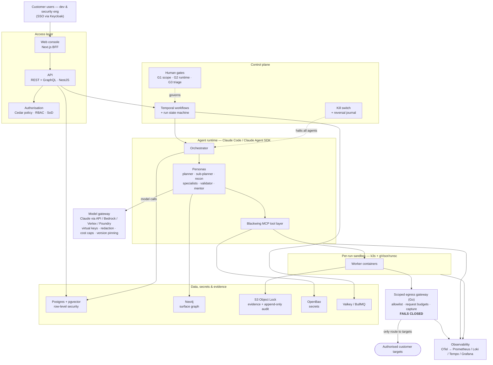

# Blackwing SaaS

**Blackwing** is an autonomous security-assessment platform that runs **under human authorisation**. It performs black-, grey- and white-box assessments with a team of AI agents (powered by **Claude Code / the Claude Agent SDK**), reaches targets only through a **scoped egress gateway that fails closed**, proves every finding with a **deterministic validator**, and releases findings only after **human triage**. Three human gates (scope approval, runtime exception, triage & release) and a customer-held **kill switch** keep it safe.

This repository is the **SaaS edition** (multi-tenant, Blackwing-operated on AWS). An on-prem single-tenant edition is tracked for later.

> **Every Claude Code session: read this file, then [`docs/architecture/CONTEXT_PACK.md`](docs/architecture/CONTEXT_PACK.md) and [`CLAUDE.md`](CLAUDE.md) before writing any code.** The CONTEXT_PACK is the single source of truth for stack (§5), repo paths (§6), domain model (§7), the security invariants you must never break (§8) and the Definition of Done (§10).

---

## Architecture at a glance

The diagram below renders on GitHub and is the quick map. The **full diagram set** — Overview plus System Context, Components, Agent Org & Data Flow, Assessment Modes and Deployment — is available two ways: an editable **draw.io / diagrams.net** file [`docs/architecture/blackwing-architecture.drawio`](docs/architecture/blackwing-architecture.drawio) (6 pages/tabs) and a static [`docs/architecture/blackwing-architecture.html`](docs/architecture/blackwing-architecture.html). The authoritative prose is [`CONTEXT_PACK.md`](docs/architecture/CONTEXT_PACK.md) §3.



**Read the diagram as:** a user acts through the **console/API**, every action is checked by **Cedar authz**; a run is driven by a **Temporal** state machine under three **human gates** and a **kill switch**; the **Claude-Code agent runtime** (orchestrator + personas + MCP tools) does the work; all model calls go through the **model gateway**; all target traffic goes through the **scoped egress gateway** (the *only* route, fails closed) from inside a **per-run gVisor sandbox**; findings are proved by the **validator** and stored with **evidence + an append-only audit ledger**; tenants are isolated by **Postgres RLS** and per-run sandboxes.

---

## UI design (source of truth for every GUI)

The console's look and behaviour come from the Claude Design export in [`design/`](design/README.md):

- [`Blackwing Design System.dc.html`](design/Blackwing%20Design%20System.dc.html): colour tokens for light and dark, Poppins and JetBrains Mono type, grid, icons and components.
- [`Blackwing Screens.dc.html`](design/Blackwing%20Screens.dc.html): pass 1 covers the live run (flight deck and transcript), the Gate 2 decision (desktop and mobile), the kill dialog and the SOC emergency link.
- [`design/tokens.json`](design/tokens.json): the tokens as data, for `packages/ui`.

**Every GUI issue (`apps/web`, `packages/ui`, SOC and emergency pages, report and e-mail templates) implements this design.** Screens it does not cover yet are composed from its design system. To view it locally: `python3 -m http.server 8099 -d design`.

---

## Feature list (v1)

> This is the customer feature list. **SaaS-edition overrides** (in `CONTEXT_PACK.md` §1.1) take precedence where they differ — notably: **multi-tenant is IN scope** for SaaS (feature 41's single-node/single-tenant is the later on-prem edition), and **"bring your own model" (36) means a Claude endpoint only** — Anthropic API, AWS Bedrock, GCP Vertex or Microsoft Foundry (no Azure OpenAI / third-party models).

| # | Area | Feature | What it does |
|---|---|---|---|
| 1 | Scoping & authorisation | Scoping form | Structured form for assets, mode, scope, intrusiveness and budget. Not a chat. |
| 2 | Scoping & authorisation | Editable test plan | Planner proposes test cases; the user can add, remove or edit them before the run. |
| 3 | Scoping & authorisation | Standing authorisation | Signed approval per asset with an expiry. Tests inside it need no new approval. |
| 4 | Scoping & authorisation | Intrusiveness class | Each test is tagged passive, active-safe or state-changing. Destructive tests are not in v1. |
| 5 | Scoping & authorisation | Request budget per test case | Caps requests per test case so the target is not overloaded. |
| 6 | Scoping & authorisation | Environment attestation | Asset owner confirms environment type and any shared database or login service. |
| 7 | Testing | Three assessment modes | Black, grey and white box. Grey box is the main mode. Recon is skipped where context is supplied. |
| 8 | Testing | Grey-box web & API testing | Runs with customer-provided logins for two or more roles. |
| 9 | Testing | Multi-role authorisation matrix | Tests every role against every function; compares expected vs actual access. |
| 10 | Testing | Session manager | Keeps logins alive and checks the session is still valid during a run. |
| 11 | Testing | Scoped egress proxy | The only route to a target. Scope and request budget are enforced here. |
| 12 | Testing | Agent team | Orchestrator, planner, sub-planner, recon, threat intel, specialists, exploit developer, mentor, reflector. |
| 13 | Testing | Runtime exception gate (Gate 2) | An action outside approved scope pauses that branch and pages on-call. No reply means denied. |
| 14 | Validation | Validator agent | Replays each finding against a check declared before the test ran. |
| 15 | Validation | Out-of-band listener | Own callback server to prove blind/delayed bugs such as blind SSRF. |
| 16 | Validation | Negative controls | Runs a harmless version of the request to confirm the result is not a false positive. |
| 17 | Validation | Confirmed & Suspected lists | Only evidence-backed findings are Confirmed; the rest stay Suspected. |
| 18 | Validation | Standalone repro artifact | Each confirmed finding ships with steps that can be replayed offline. |
| 19 | Validation | Coverage manifest | Lists what was tested and what was not. A report cannot be exported without it. |
| 20 | Validation | Reversal journal | Records every change made to the target so it can be undone. |
| 21 | Findings & triage | Triage gate (Gate 3) | A person reviews findings before the report is released. |
| 22 | Findings & triage | Dedup & fingerprinting | Stable ID per finding so repeat runs do not create duplicates. |
| 23 | Findings & triage | Baseline run | First run becomes the reference; later runs show new / open / fixed / returned. |
| 24 | Findings & triage | One-click retest | Re-checks a single finding after a fix. |
| 25 | Reporting & integrations | Report export | PDF, JSON and SARIF. |
| 26 | Reporting & integrations | OWASP & CWE mapping | Every finding tagged with OWASP category and CWE ID. |
| 27 | Reporting & integrations | Jira & GitHub/GitLab push | Creates and updates one ticket or issue per finding. |
| 28 | Reporting & integrations | Vulnerability dashboard | Findings by severity, asset and status, with trend across runs. |
| 29 | Platform & governance | One web console | Same web UI for developers and security engineers, separated by roles. |
| 30 | Platform & governance | SSO | Sign in with the customer's identity provider (Microsoft, Google, GitHub, Slack). |
| 31 | Platform & governance | Separation of duties | The person who requests a test cannot be the one who approves it. |
| 32 | Platform & governance | Customer-owned policy layer | Customer sets its own rules for allowed targets, actions and hours. |
| 33 | Platform & governance | Kill switch | Stops all agents at once. Halt time is measured and shown. |
| 34 | Platform & governance | Audit ledger | Append-only record of every login, approval, tool action and release. |
| 35 | Platform & governance | Secrets on customer key store | Credentials stay in the customer's own KMS or vault. |
| 36 | Platform & governance | Bring your own model | **SaaS: a Claude endpoint only** — Anthropic API / AWS Bedrock / GCP Vertex / Microsoft Foundry. No data goes to other providers. |
| 37 | Platform & governance | Pinned versions | Model, prompt and tool versions are fixed per run and recorded. |
| 38 | Platform & governance | Cost cap | Maximum model spend per run. |
| 39 | Platform & governance | Retention | Customer sets how long findings, evidence and logs are kept. |
| 40 | Platform & governance | Evaluation harness | Fixed set of known-vulnerable targets re-run after any model/prompt/tool change. |
| 41 | Platform & governance | Single-node deployment | *Later on-prem edition* — installs in the customer's own cloud, single tenant. |
| 42 | Later | Bitbucket / Azure DevOps / ServiceNow | Push findings to more ticketing & SCM tools. |
| 43 | Later | Diff-driven continuous assessment | Test only what changed in each release. |
| 44 | Later | Auto-release lane in triage | Low-risk, repeatedly-confirmed finding types skip manual release. |

**Explicitly NOT in v1:** destructive tests · SAST/SCA scanning · CI build-gating · SLA tracking · chat-based scoping · a second developer UI. (Multi-tenant *is* in v1 for the SaaS edition.)

Full table and notes: [`docs/architecture/FEATURE_LIST.md`](docs/architecture/FEATURE_LIST.md).

---

## Build workflow — START HERE (every session)

The repo is **greenfield**: the code is built by the GitHub issues themselves, in order.

1. **Clone & authenticate** (a GitHub token with repo scope is required):
   ```bash
   export GH_TOKEN=<token>
   gh repo clone TinycrowsLab/Blacwing_SAAS && cd Blacwing_SAAS
   ```
2. **Read** `README.md` (this file) → `docs/architecture/CONTEXT_PACK.md` → `CLAUDE.md`.
3. **Work milestone by milestone**: `M0 → M1 → … → M9 → Later`. Within a milestone, only start an issue whose **blocked-by issues are all closed** (see the issue's "Blocked by" / the project board). Prefer `priority:P0`, then P1…
4. **First issue to build: [#3 — Initialise the pnpm + Turborepo monorepo and scaffold every app/package].** It creates the skeleton everything else builds on.
5. **One issue at a time**: implement to the Definition of Done (`CONTEXT_PACK.md` §10 — tests, isolation, audit, observability, docs), then close the issue (`Closes #N`) and move the board item to **Done**.

**Milestones** (GitHub milestone → theme):
`M0` Foundations & Dev Environment · `M1` Platform Core (tenancy, identity, data, audit, secrets) · `M2` Assets, Scoping, Authorisation & Policy · `M3` Execution Sandbox & Egress · `M4` Agent Runtime on Claude Code · `M5` Recon, Planning & Specialists · `M6` Validation, Evidence & Findings · `M7` Triage, Reporting & Integrations · `M8` Console & Dashboards · `M9` Production Readiness & Launch · `Later` Post-v1 backlog.

---

## Local setup

Requirements: **Node.js 22 LTS** (pinned in `.nvmrc` / `.node-version`) and **pnpm 9** (pinned via `packageManager`; run `corepack enable`).

```bash
pnpm install --frozen-lockfile   # preinstall refuses npm/yarn, Node != 22, and layout drift
pnpm check:layout                # JSON summary of workspace members; non-zero exit on drift
pnpm typecheck                   # turbo: tsconfig check, then strict tsc -b per member (cached)
pnpm test                        # scripts/ self-tests + every workspace member's tests
```

### Task pipeline (Turborepo)

Root scripts delegate to [Turborepo](https://turborepo.com) (`turbo.json`, pinned `turbo` devDependency); each package declares its own scripts and turbo runs them in dependency order with a **local filesystem cache** (`.turbo/cache`, gitignored). The remote cache is disabled in v1 (`remoteCache.enabled: false`), even if `TURBO_TOKEN` is set.

| Command | Turbo task | Depends on | Cached | Outputs |
|---|---|---|---|---|
| `pnpm build` | `build` | `^build` (workspace deps build first) | yes | `dist/**` |
| `pnpm typecheck` | `typecheck` (+ root `check:tsconfig`) | `^build`, `^typecheck`, `//#check:tsconfig` | yes | none |
| `pnpm lint` | `lint` | `^build` | yes | none |
| `pnpm test` | `test` (+ root `test:scripts`) | `^build`, `//#test:scripts` | yes (`test:scripts`: no) | `coverage/**` |
| `pnpm test:int` | `test:int` | `^build` | **no** (external services) | — |
| `pnpm test:e2e` | `test:e2e` | `^build` | **no** (external services) | — |
| `pnpm dev` | `dev` (`--parallel`) | — | **no**, persistent | — |

- Cached tasks hash every git-tracked file of the package (`$TURBO_DEFAULT$`, so nested projects such as `packages/testing/typefixtures` count) plus `src/**`, `tsconfig*.json` and `package.json`; gitignored `dist/` and `.turbo/` never count. Changing `tsconfig.base.json`, the root `tsconfig.json`, the ESLint/Prettier config or `.nvmrc` busts every cache (`globalDependencies`). `typecheck` also waits for `^typecheck` because `tsc -b` builds referenced projects, which must not run concurrently.
- `envMode` is strict: a task only sees the environment variables its definition lists. Add new ones to `turbo.json` (`env` if they change the output, `passThroughEnv` otherwise).
- A package whose `build` writes no `dist/` must declare it in its own `turbo.json`, otherwise a cache hit restores nothing:
  ```json
  { "extends": ["//"], "tasks": { "build": { "outputs": [] } } }
  ```
- `test` declares `coverage/**` so coverage reports (`pnpm test -- --coverage`) are cached and restored. Until coverage is on by default (CI-002, #137), plain `pnpm test` prints turbo's "no output files found" warning for each package; it is expected and harmless (the arguments are part of the hash, so a run without coverage never restores one with it).
- Root tasks (`//#check:tsconfig`, `//#test:scripts`) feed the hash of every package task that depends on them, so they declare narrow explicit `inputs`.
- `pnpm check:turbo` validates the pipeline contract. Add `--summarize` to any task (`pnpm build --summarize`) to write a run summary to `.turbo/runs/` (the CI artifact), then `pnpm check:turbo --latest-summary` fails if a task declared outputs it did not produce.
- Inspect the graph without running anything: `pnpm exec turbo run build --dry=json`.
- Turbo's anonymous telemetry can be switched off per machine with `pnpm exec turbo telemetry disable` (or `TURBO_TELEMETRY_DISABLED=1`).
- After changing `turbo.json`, refresh the dry-run snapshot used by the self-tests: `BW_UPDATE_SNAPSHOTS=1 pnpm test:scripts`.

The workspace (`pnpm-workspace.yaml`: `apps/*`, `packages/*`) holds 9 apps and 23 packages, each named `@blackwing/<dir>`, exactly as laid out in [`CONTEXT_PACK.md` §6](docs/architecture/CONTEXT_PACK.md). `scripts/check-layout.mjs` enforces that layout; when an issue adds or removes an app, package or fixed directory, update its expected lists and §6 in the same commit.

Every member extends the strict root `tsconfig.base.json` and is wired into one incremental `tsc -b` build through project references; `scripts/check-tsconfig.mjs` guards that setup. See [`docs/architecture/typescript.md`](docs/architecture/typescript.md) for the options, the `apps/web` exception, the `import type` pattern and how to add a workspace dependency.

---

## Repository map

| Path / resource | What it is |
|---|---|
| [`docs/architecture/CONTEXT_PACK.md`](docs/architecture/CONTEXT_PACK.md) | **Source of truth** — product, architecture, run state machine, Claude runtime & personas, stack, paths, domain model, security invariants (§8), Definition of Done (§10). |
| [`docs/architecture/blackwing-architecture.drawio`](docs/architecture/blackwing-architecture.drawio) | Editable draw.io diagram set — 6 pages (Overview + 5 views). |
| [`docs/architecture/blackwing-architecture.html`](docs/architecture/blackwing-architecture.html) | Static interactive diagrams. |
| [`docs/architecture/FEATURE_LIST.md`](docs/architecture/FEATURE_LIST.md) | The complete feature list. |
| [`docs/architecture/EPICS.md`](docs/architecture/EPICS.md) | Epic catalogue. |
| [`docs/architecture/REFERENCES.md`](docs/architecture/REFERENCES.md) | Prior-art, OSS tooling, orchestration patterns, persona template, standards IDs. |
| [`design/`](design/README.md) | **UI source of truth**: Claude Design export (design system, screens, `tokens.json`). |
| [`CLAUDE.md`](CLAUDE.md) | Per-session working rules and the non-negotiable invariants. |
| GitHub Issues | 69 epics + ~771 self-contained task issues, dependency-wired. |
| *Blackwing SaaS v1* project board | Kanban view (Backlog / Ready / In progress / In review / Blocked / Done). |

## Status
Pre-implementation: the architecture and the full v1 backlog (~840 issues) are defined and dependency-wired. Implementation proceeds issue by issue, milestone by milestone.
