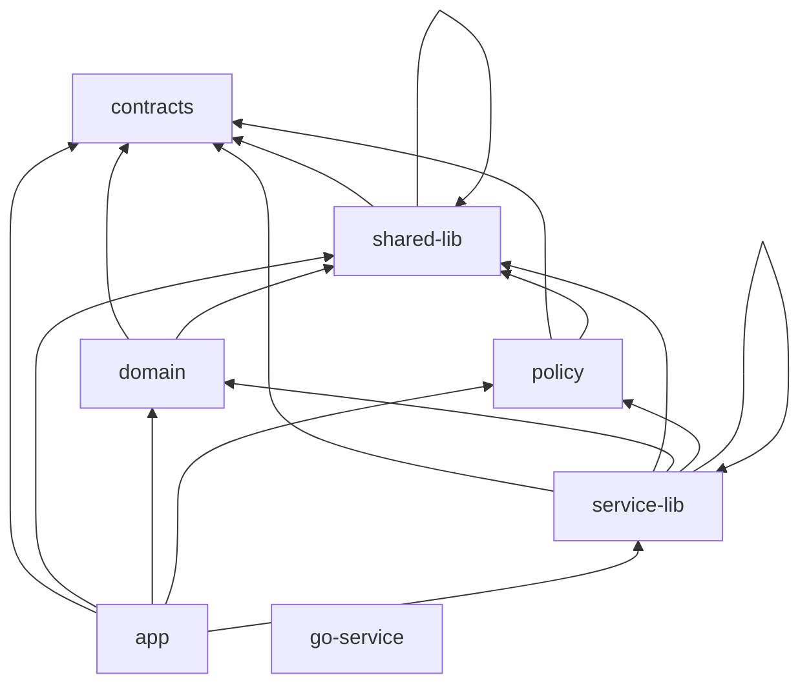

# Allowed package dependency graph

<!-- Generated by `pnpm boundaries:docs` from scripts/check-boundaries.mjs. Do not edit by hand:
     `pnpm boundaries:check` fails when this file differs from the generated text. -->

Every workspace member belongs to exactly one element type. `pnpm boundaries:check` (FOUND-005, #7)
enforces the edges below on every import, including type-only imports (`import type`,
`export type ... from`), dynamic `import()` and `require`, and on the workspace dependencies
declared in each `package.json`. Imports resolve through the pnpm workspace symlinks to the real
member paths; an import that cannot be resolved (for example an undeclared `@blackwing/*`
dependency) is matched by its package name and also reported as unresolvable.

The model lives in `scripts/check-boundaries.mjs` (`ELEMENT_TYPES`). To change the graph, edit it,
run `pnpm boundaries:docs` and commit both files with an explanation of the new edge.

## Element types

| Type | May import | Members | Purpose |
|---|---|---|---|
| `contracts` | nothing internal | `packages/contracts` | Zod schemas shared by every layer (CONTEXT_PACK §5). The root of the graph. |
| `shared-lib` | `contracts`, `shared-lib` | `packages/config`, `packages/crypto`, `packages/errors`, `packages/ids`, `packages/logger`, `packages/telemetry`, `packages/testing`, `packages/time` | Cross-cutting foundation libraries: config, errors, ids, logging, time, telemetry, crypto primitives, test helpers. |
| `domain` | `contracts`, `shared-lib` | `packages/domain` | Pure domain logic: run state machine, finding lifecycle, dedup and fingerprinting. |
| `policy` | `contracts`, `shared-lib` | `packages/policy` | Deterministic policy decision point (Cedar). Kept free of app and service coupling (CONTEXT_PACK §8.11). |
| `service-lib` | `contracts`, `shared-lib`, `domain`, `policy`, `service-lib` | `packages/agents`, `packages/audit`, `packages/connectors`, `packages/cost`, `packages/db`, `packages/events`, `packages/evidence`, `packages/mcp-tools`, `packages/memory`, `packages/notify`, `packages/oob`, `packages/replay`, `packages/reporting`, `packages/secrets`, `packages/ui` | Platform, data-access and integration libraries used by the apps. |
| `app` | `contracts`, `shared-lib`, `domain`, `policy`, `service-lib` | `apps/agent-runtime`, `apps/api`, `apps/cli`, `apps/model-gateway`, `apps/sandbox-controller`, `apps/session-manager`, `apps/web`, `apps/worker` | TypeScript deployables. They compose packages and never reach into another app. |
| `go-service` | nothing internal | `apps/egress-gateway` | The Go egress gateway. Its TypeScript stub imports nothing internal; its Go module stays self-contained. |

Members of `shared-lib` may depend on each other (for example `packages/config -> packages/errors`
and `packages/logger -> packages/config`), and so may members of `service-lib`, but never in a
cycle.

## Graph

An arrow means "may import". Anything without an arrow is rejected.

## Matrix

| from \ to | `contracts` | `shared-lib` | `domain` | `policy` | `service-lib` | `app` | `go-service` |
|---|:---:|:---:|:---:|:---:|:---:|:---:|:---:|
| `contracts` | no | no | no | no | no | no | no |
| `shared-lib` | yes | yes | no | no | no | no | no |
| `domain` | yes | yes | no | no | no | no | no |
| `policy` | yes | yes | no | no | no | no | no |
| `service-lib` | yes | yes | yes | yes | yes | no | no |
| `app` | yes | yes | yes | yes | yes | no | no |
| `go-service` | no | no | no | no | no | no | no |

A member never counts as a dependency of itself, so `app -> app` means "another app".

## Additional rules

- **Test code may also import `@blackwing/testing`, and only test code may.** Test code is any `*.test.*` or `*.spec.*` file, anything under a `test/`, `tests/`, `__tests__/`, `__fixtures__/`, `e2e/`, `testdata/` or `typefixtures/` directory, and `vitest.config.*` / `vitest.int.config.*` / `playwright.config.*` (`TEST_CODE_PATTERN`). In `package.json`, `@blackwing/testing` belongs in `devDependencies`. Test code gets no other exemption.
- **No deep imports.** Import another member only through its public entry points (the targets of its `package.json` `exports`): `@blackwing/config`, never `@blackwing/config/src/...` and never a relative path into another member. An `exports` map must not expose a `./src/...` subpath.
- **Sandbox code stays away from server-only packages.** `apps/agent-runtime` and `packages/mcp-tools` run inside agent sandboxes, which reach only the egress gateway, the model gateway and the Run Broker API (CONTEXT_PACK §4.1). Their production code must not reach `packages/audit`, `packages/connectors`, `packages/db`, `packages/notify`, `packages/secrets`, directly or through another package (§8.6, §8.7).
- **The Go service stays self-contained.** `apps/egress-gateway/go.mod` must not `replace` a module with a path outside the module, and its Go code must not import other paths of this repository.
- **No cycles.** Package cycles (from imports and declared dependencies) and module cycles inside one package are reported separately from boundary violations.
- **Every member is classified.** A new app or package fails the check until it is added to `ELEMENT_TYPES`.

## Commands and report

| Command | Does |
|---|---|
| `pnpm boundaries:check` | Checks the whole workspace and this file. Exits 1 and names each offending edge on violation. |
| `pnpm boundaries:report` | Same check, and also writes `boundaries-report.json` for CI annotation. |
| `pnpm boundaries:docs` | Regenerates this file from the model. |

The JSON report has `ok`, `summary`, `violations` and `cycles`. Each violation carries `kind`
(`unclassified`, `boundary`, `test-only`, `server-only`, `deep-import`, `unresolvable`, `go`, `docs`), `rule`, `from`, `to`,
`specifier` (the import as written), `fromMember`, `fromType`, `toMember`, `toType`, `via` (for
transitive violations) and `message`.
Each cycle carries `kind` (`package-cycle` or `module-cycle`), `rule`, `path` and `message`. Under
GitHub Actions every problem is also printed as an `::error` annotation.
