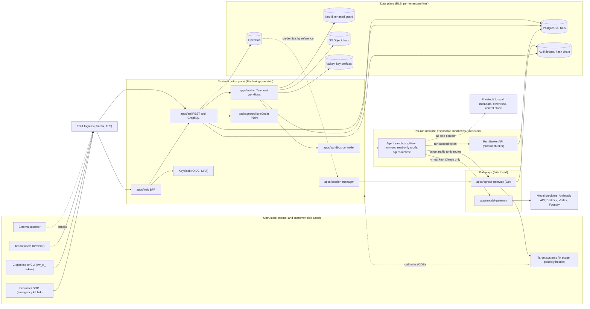
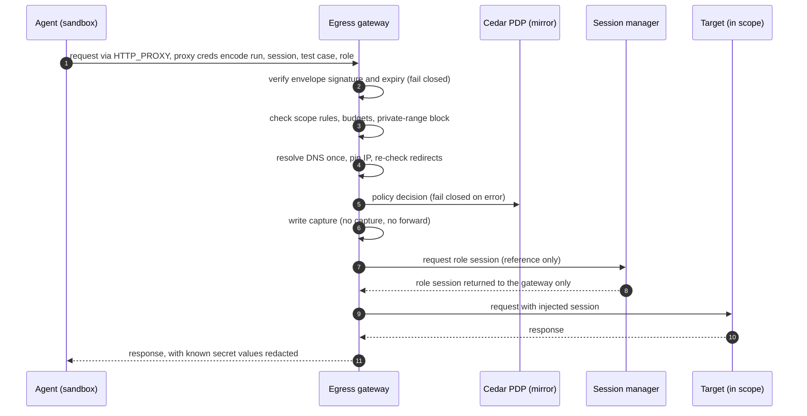

# Blackwing platform threat model

This is the shared picture of what Blackwing defends, from whom, and by which deterministic mechanism. It covers the
platform as a system: trust boundaries, data flows, assets, adversaries, the threats at each boundary (STRIDE), the
mitigation for each threat, the [§8](CONTEXT_PACK.md#8-security-invariants-every-issue-must-preserve-these-tests-must-prove-the-ones-they-touch)
invariant it relies on, and the epic that owns it. It also records the residual risks and the sign-off status.

It is a living document (see [Change procedure](#9-change-procedure)). It grounds the invariant matrix (SECREVIEW-002)
and the abuse tests (SECREVIEW-003 and SECREVIEW-004). The automated tests themselves, and infrastructure controls
(INFRA), are out of scope here.

Normative sources: [CONTEXT_PACK §3](CONTEXT_PACK.md#3-architecture-saas) (architecture),
[§4.1](CONTEXT_PACK.md#41-topology) (sandbox and egress topology), [§4.5](CONTEXT_PACK.md#45-policy--terms-constraints-must-follow)
(policy and prompt injection), [§7](CONTEXT_PACK.md#7-core-domain-model-tables-in-packagesdb-all-tenant-tables-have-tenant_id-uuid-not-null--rls)
(domain) and [§8](CONTEXT_PACK.md#8-security-invariants-every-issue-must-preserve-these-tests-must-prove-the-ones-they-touch)
(invariants).

> **Note**: the threat model describes the target design. Each mitigation is owned by an epic. Whether a mitigation is
> built yet is tracked by that epic's issues, not by this page.

## Contents

1. [The two highest-stakes properties](#1-the-two-highest-stakes-properties)
2. [Assets](#2-assets)
3. [Trust boundaries and data flows](#3-trust-boundaries-and-data-flows)
4. [Adversary catalogue](#4-adversary-catalogue)
5. [Threats, mitigations and invariants by boundary](#5-threats-mitigations-and-invariants-by-boundary)
6. [Invariant coverage matrix](#6-invariant-coverage-matrix)
7. [Residual-risk register](#7-residual-risk-register)
8. [Gaps and non-mitigations](#8-gaps-and-non-mitigations)
9. [Change procedure](#9-change-procedure)
10. [Sign-off](#10-sign-off)

## 1. The two highest-stakes properties

### 1.1 Target content is untrusted, and enforcement never depends on the model

Every byte that comes from a target is untrusted data: HTTP bodies, HTML, JavaScript, source code, DNS records,
certificate transparency entries, archived pages and OSINT material. An attacker who controls a target can put
instructions in that content to steer the agent (prompt injection, [§4.5](CONTEXT_PACK.md#45-policy--terms-constraints-must-follow)).

The model is never a control ([§8.11](CONTEXT_PACK.md#8-security-invariants-every-issue-must-preserve-these-tests-must-prove-the-ones-they-touch)).
Each safety property is enforced by deterministic code that sits outside the model:

- the PreToolUse hook, which asks the policy decision point (PDP) before every Bash command and every target-interaction
  tool call;
- the egress gateway, which decides every target connection, DNS answer and redirect;
- the request, time and cost budgets;
- the kill switch and the envelope expiry;
- the destructive-class hard block, the reversal-journal precondition and the separation-of-duties check.

A prompt-injected agent can ask for anything. The only thing it can do is send requests through the controls above, and
those controls decide the outcome without reading the model's intent.

### 1.2 The platform must not attack itself or third parties outside authorisation

Blackwing sends real traffic. Two failure modes are unacceptable:

- **Attacking itself.** A sandbox or a target reaches Blackwing infrastructure: the control plane, the data stores, the
  cloud metadata endpoint, or another run's sandbox (SSRF of our own infrastructure).
- **Attacking third parties.** Traffic reaches a host that is not in a verified asset, not in the standing
  authorisation's scope, outside the test window, outside the envelope, or in the destructive class.

Deterministic controls that prevent both:

| Control | Mechanism | Invariant |
|---|---|---|
| Ownership verification | An unverified asset cannot be targeted (DNS TXT, HTTP file or manual letter). | [§8.10](CONTEXT_PACK.md#8-security-invariants-every-issue-must-preserve-these-tests-must-prove-the-ones-they-touch) |
| Signed envelope | Target traffic needs a signature-verified, unexpired envelope. Expiry mid-run blocks at once. | [§8.1](CONTEXT_PACK.md#8-security-invariants-every-issue-must-preserve-these-tests-must-prove-the-ones-they-touch) |
| Scope rules and private-range block | Include and exclude rules are enforced on hosts, paths, ports and methods. Private, link-local and metadata ranges are blocked unless explicitly in scope. | [§8.2](CONTEXT_PACK.md#8-security-invariants-every-issue-must-preserve-these-tests-must-prove-the-ones-they-touch) |
| Destructive class blocked | The baseline policy hard-blocks the destructive class. `state_changing` needs an approved SA, Gate 1 and a journal entry. | [§8.3](CONTEXT_PACK.md#8-security-invariants-every-issue-must-preserve-these-tests-must-prove-the-ones-they-touch) |
| Egress network policy | The sandbox has three allowed destinations (§1.2.1 below). All other traffic is denied at the network layer. | [§8.2](CONTEXT_PACK.md#8-security-invariants-every-issue-must-preserve-these-tests-must-prove-the-ones-they-touch) |
| Budgets and kill | Request, rate and cost budgets per test case. The kill switch stops everything in scope. | [§8.5](CONTEXT_PACK.md#8-security-invariants-every-issue-must-preserve-these-tests-must-prove-the-ones-they-touch) |

#### 1.2.1 Sandbox egress: three destinations only

Every agent sandbox ([§4.1](CONTEXT_PACK.md#41-topology)) may reach exactly three destinations. All other egress is denied
(Kubernetes NetworkPolicy plus host firewall):

1. the **egress gateway**, for target traffic;
2. the **model gateway**, for Claude, with a per-session virtual key;
3. the **Run Broker API** (`/internal/broker/*`), for tool backends, with a run-scoped token.

Not reachable from a sandbox: the internet, the cloud metadata endpoint (169.254.169.254), the host Docker socket, other
runs, and the platform's own control plane.

## 2. Assets

| ID | Asset | Why it matters | Primary store or component |
|---|---|---|---|
| A-1 | Tenant assets and their ownership proof | Defines what may be tested. Wrong ownership means attacking a third party. | `assets`, verification records |
| A-2 | Standing authorisations (SA) and envelopes | The legal basis for all traffic. Signed and expiring. | `standing_authorisations`, envelope store |
| A-3 | Test plans and approvals (Gate 1, Gate 2) | Human decisions that authorise actions. Requester must differ from approver. | `test_plans`, `gate_decisions` |
| A-4 | Findings, evidence and repro artifacts | Confidential and sensitive (exploitable). Must be tamper-evident. | `findings`, `evidence_items` (S3 Object Lock) |
| A-5 | Tenant data in general | Confidentiality between tenants. | Postgres (RLS), Neo4j, S3, Valkey |
| A-6 | Credentials for target roles | Can log into customer systems. Must never be plaintext outside the gateway. | `secrets`, `asset_credentials` (references only), OpenBao |
| A-7 | Platform secrets and signing keys | Compromise lets an attacker mint envelopes or read tenant data. | OpenBao KV v2 and Transit |
| A-8 | Model provider credentials | Billing and data-processing authority. Must not reach sandboxes. | Model gateway only |
| A-9 | Audit ledger | Proof of who approved and did what. Must be append-only. | `audit_events` (hash chain per tenant) |
| A-10 | Platform availability and kill capability | Needed to stop a run quickly. | Kill path, Temporal, egress gateway |
| A-11 | Platform infrastructure (control plane, k3s, egress gateway) | Must not be a target of sandbox or target traffic. | Platform network |
| A-12 | Build artifacts and images (sandbox image, binaries) | Supply-chain integrity for every run. | GHCR, cosign, SBOM |

## 3. Trust boundaries and data flows

### 3.1 Component view with trust boundaries

### 3.2 Egress and credential flow for one target request

The agent never receives role credentials. They are resolved and injected inside the gateway.

## 4. Adversary catalogue

| ID | Adversary | Capability | Goal | Boundaries they reach |
|---|---|---|---|---|
| ADV-1 | External attacker | Internet access, no account | Steal tenant data, take over accounts, abuse the platform for attacks | TB-1, TB-2 |
| ADV-2 | Malicious or curious tenant user | Valid account in one tenant, may hold admin or developer role | Read other tenants' data, target assets they do not own, bypass approvals | TB-2, TB-3, TB-8, TB-10 |
| ADV-3 | Compromised or prompt-injected agent session | Controls the content the agent reads (a target's HTTP, DOM, source or DNS). Can issue any tool call. | Reach out-of-scope hosts, the platform itself or other tenants; forge findings; exfiltrate secrets | TB-5, TB-6, TB-7, TB-8 |
| ADV-4 | Malicious insider or rogue platform operator | Platform operator access (see §1.2 of the pack), infrastructure access | Read tenant data, alter audit history, flip kill or release state, change policy | TB-4, TB-9 |
| ADV-5 | Supply-chain attacker | Compromises a dependency, build step, image, or an upstream binary (SDK, Claude Code, tool) | Run malicious code in the platform or in every sandbox | TB-11 |
| ADV-6 | Curious cross-tenant tenant | A tenant with its own legitimate use, probing for side channels | Infer another tenant's assets, findings or activity from timing, shared caches or shared infrastructure | TB-8 |

ADV-3 is the case the platform is built around. It has no account and no trust. The agent is a tool that an adversary
who controls target content can steer.

## 5. Threats, mitigations and invariants by boundary

Columns: **ID** (threat), **STRIDE**, **Threat**, **Deterministic mitigation**, **§8** (invariant relied on),
**Owner** (epic that builds the mitigation). Threats are described at functional altitude. No payloads or walkthroughs
are included (content-safety rule for this document).

### TB-1: Internet and customer actors to ingress and console

| ID | STRIDE | Threat | Deterministic mitigation | §8 | Owner |
|---|---|---|---|---|---|
| T-01 | S | Account takeover of a console user (credential stuffing, reused passwords) | Keycloak MFA and brute-force detection; OIDC Auth Code with PKCE through the Next.js BFF; tokens never reach the browser; httpOnly cookies | 8.8 | IAM |
| T-02 | S | Use of a stolen API token (`bw_pat_`, `bw_ci_`) | Tokens stored as SHA-256 hashes with prefix lookup; expiry, revocation and `last_used_at`; scopes bound to `asset_ids` or an SA | 8.6, 8.10 | RBAC |
| T-03 | T, I | Interception or downgrade of traffic in transit | TLS terminated at ingress with cert-manager certificates; HSTS; no plaintext listener for the API | supporting | INFRA |
| T-04 | D | Flooding of the API or the login endpoint | Per-token rate limits (429 with `Retry-After`); edge rate limits; no unauthenticated expensive endpoints | supporting | API |
| T-05 | E | Kill-link token abused to stop another tenant's run, or reused after the event | The SOC kill link is signed, scoped to one run, asset or tenant, and expires; use is audited; the link needs no Blackwing account, but grants only the kill action | 8.5, 8.8 | KILL |
| T-06 | R | An actor denies having approved a gate or a release | Every login, approval, gate decision and release writes an audit event in the same transaction (outbox); the ledger is hash-chained per tenant | 8.8 | AUDIT |

### TB-2: Console BFF and API (session cookie or bearer token)

| ID | STRIDE | Threat | Deterministic mitigation | §8 | Owner |
|---|---|---|---|---|---|
| T-07 | I, E | IDOR: one tenant's user reads or changes another tenant's objects | Every request runs in `withTenant` (`SET LOCAL app.tenant_id`); RLS with no `BYPASSRLS` on the app role; missing tenant context fails closed; Cedar resource check; cross-tenant tests per data-access module | 8.6 | TENANT, DB, POLICY |
| T-08 | E, T | Requester approves their own standing authorisation, plan or Gate 2 (mass assignment or direct call) | `requester_id` set server-side from the session; DB check constraint or trigger `approver_id <> requester_id`; Cedar check; SoD tested for SA, Gate 1 and Gate 2 | 8.4 | AUTHZ, PLAN, GATE2 |
| T-09 | R | A state change happens with no audit event | Domain change and audit event (or outbox row) written in one transaction by `withOutbox` | 8.8 | AUDIT |
| T-10 | I | Internal details leak through error responses or logs | RFC 9457 problem+json with stable codes; no stack traces; logger redaction paths; no secrets in errors | 8.7 | API, OBS |

### TB-3: API and Temporal workers (signals, workflows, schedules)

| ID | STRIDE | Threat | Deterministic mitigation | §8 | Owner |
|---|---|---|---|---|---|
| T-11 | S, T | A forged gate signal approves Gate 2 or Gate 1 without a human | Signals accepted only from the authenticated service identity; each decision records the actor; requester is not approver; timeout means deny | 8.4 | GATE2, WORKFLOW |
| T-12 | D | A run keeps going after a kill, a window closes or an SA expires | Kill cancels Temporal workflows; window and expiry are timers; expiry mid-run stops all traffic | 8.1, 8.5 | KILL, ORCH |
| T-13 | T | Non-deterministic replay changes the behaviour of a run already in progress | Determinism lint on workflow code; `patched()` and Build IDs for versioning; pinned versions per run | 8.9 | WORKFLOW |
| T-14 | E | Run started with a budget or model setting that was not approved | Run manifest pins budgets and model IDs; the approved envelope hash is recorded; runs do not float | 8.9 | ORCH, REGISTRY |

### TB-4: Control plane and data stores

| ID | STRIDE | Threat | Deterministic mitigation | §8 | Owner |
|---|---|---|---|---|---|
| T-15 | I | Cross-tenant read from Postgres through a missing or wrong tenant setting | RLS on every tenant table (`tenant_id = current_setting('app.tenant_id')`), forced for the owner; migrations run as a separate owner role; `withSystem` is the only bypass and is audited | 8.6 | DB |
| T-16 | I | Plaintext secret read from the database | Secret records hold only `secret_ref`; values are envelope-encrypted by OpenBao Transit; consumers use the Secrets Service, not the tables | 8.7 | SECRETS |
| T-17 | T | Audit events edited, reordered or removed | Append-only grants; per-tenant hash chain with a verifier; evidence in S3 Object Lock with `legal_hold` and `retention_until` | 8.8 | AUDIT, EVIDENCE |
| T-18 | I | Cross-tenant read of objects in S3 | Per-tenant key prefixes and per-tenant encryption context; no list across tenants | 8.6 | EVIDENCE, RETAIN |
| T-19 | I | Cross-tenant data in Valkey (queues, cache, live events) | Every key carries a tenant prefix; BullMQ and Redis Streams are tenant-scoped | 8.6 | WORKFLOW |
| T-20 | I | Cross-tenant retrieval from the asset graph or memory | Neo4j queries require a `tenantId` guard enforced by the repository layer; no cross-tenant retrieval in memory | 8.6 | GRAPH, MEMORY |

### TB-5: Sandbox to egress gateway (target traffic)

This is the highest-risk path. Every rule here is enforced in the gateway, not in the agent.

| ID | STRIDE | Threat | Deterministic mitigation | §8 | Owner |
|---|---|---|---|---|---|
| T-21 | E (SSRF of platform) | Target traffic is pointed at the platform's own infrastructure, the metadata endpoint or private ranges | Private, link-local and metadata ranges are blocked unless explicitly in scope; sandbox network policy denies everything except the gateway; the gateway runs in its own network | 8.2 | EGRESS, INFRA |
| T-22 | E | Redirect or DNS answer sends traffic to an out-of-scope host (DNS rebinding) | Resolve once and pin the IP; re-check scope on every redirect and every new connection; out-of-scope answers blocked | 8.2 | EGRESS |
| T-23 | D (fail open) | Gateway cannot read policy, reach its config or write capture, and still forwards | Fail closed: if policy evaluation, config or capture fails, the request is blocked; data planes bind only after readiness and deny on readiness loss | 8.2 | EGRESS |
| T-24 | S, T | Forged or unsigned envelope accepted | Signature verified on load and on every policy refresh; pinned signing key ID; invalid signature means no traffic | 8.1 | EGRESS, AUTHZ |
| T-25 | E | Traffic continues after the envelope expires or the SA is revoked | Expiry checked on every request and refresh; expiry mid-run blocks immediately and the run stops (`expired` state) | 8.1 | EGRESS, ORCH |
| T-26 | E | An out-of-scope or destructive action (denial of service, mass lockout, data deletion) | Destructive class hard-blocked by the baseline policy; per-test-case request, rate and byte budgets; `state_changing` needs SA, Gate 1 and a journal entry | 8.3 | POLICY, SCOPE, REVERSAL |
| T-27 | I | Credentials for target roles reach the sandbox or the model | Session manager and gateway inject role sessions at the gateway; the sandbox receives only a reference; known values redacted from tool output | 8.7 | SESSION, EGRESS |
| T-28 | E | A tool that ignores proxy settings reaches the target directly | Sandbox network policy denies direct egress; tools that ignore proxy variables run under the proxy chaining wrapper; direct traffic is dropped at the network layer | 8.2 | SANDBOX, IMAGE |
| T-29 | R | Target traffic happens with no evidence | Capture is a precondition: no capture, no forward; capture metadata goes to the evidence store with a hash | 8.2, 8.8 | EGRESS, EVIDENCE |
| T-30 | E | Traffic to a host whose ownership was never verified | Gateway refuses targets whose asset is not `verified`; the verification state is part of the envelope | 8.10 | ASSET, EGRESS |

### TB-6: Sandbox to model gateway

| ID | STRIDE | Threat | Deterministic mitigation | §8 | Owner |
|---|---|---|---|---|---|
| T-31 | I | Real provider credentials are read from the sandbox | Sandbox holds only a per-session virtual key (`bwk_`), short-lived, scoped to run and session, revoked on kill; provider keys live only in the model gateway | 8.5, 8.7 | GATEWAY |
| T-32 | I | Target content or run data goes to a provider that is not approved for the tenant | The gateway routes only to Claude endpoints approved for the tenant (Blackwing-managed Anthropic API, the tenant's API key, Bedrock, Vertex or Foundry); no other providers exist in the route table | 8.7 | GATEWAY |
| T-33 | I | Known secret values appear in prompts or model output | Redaction of known secret values in PostToolUse (`updatedToolOutput`) and again in the model gateway | 8.7 | RUNTIME, GATEWAY |
| T-34 | E | A prompt-injected agent ignores its instructions and acts out of scope | Not mitigated by the model. The PDP hook, the egress gateway and the budgets decide. See [§8](#8-gaps-and-non-mitigations). | 8.11 | RUNTIME, POLICY, EGRESS |
| T-35 | D | Runaway token or cost spend | Cost caps and spend limits in the gateway (primary); `maxBudgetUsd` in the SDK (secondary); `maxTurns` per persona | supporting (F38) | COST, GATEWAY |

### TB-7: Sandbox to Run Broker API (`/internal/broker/*`)

| ID | STRIDE | Threat | Deterministic mitigation | §8 | Owner |
|---|---|---|---|---|---|
| T-36 | E, T | A sandbox writes candidate findings, evidence or journal entries for another run or tenant | Broker is reachable only from the sandbox network; run-scoped tokens; every write is bound to the token's run and tenant and checked against the DB | 8.6 | API, MCP |
| T-37 | T | A sandbox claims a finding is confirmed without proof | Only the deterministic validator confirms: replay in a fresh sandbox against a pre-declared oracle, with negative controls; Gate 3 release is human | 8.11 | VALIDATE, TRIAGE |
| T-38 | R | A state-changing action runs with no reversal entry | PreToolUse denies `state_changing` calls with no prior journal entry; the broker requires the entry before the action is recorded | 8.3 | REVERSAL, RUNTIME |

### TB-8: Tenant to tenant

| ID | STRIDE | Threat | Deterministic mitigation | §8 | Owner |
|---|---|---|---|---|---|
| T-39 | I, E | Sandboxes of two runs, or two tenants, reach each other | One run network per run; one sandbox per agent session; no route between runs; per-session workspace on tmpfs | 8.6 | SANDBOX, INFRA |
| T-40 | I | Memory or knowledge leaks across tenants | Per-tenant memory with no cross-tenant retrieval; tenant guard on every memory query | 8.6 | MEMORY |
| T-41 | I | Side channel between tenants (timing, shared caches, shared queues) | Tenant-prefixed keys and queues; per-tenant rate limits; no shared cache of tenant-visible data | 8.6 | WORKFLOW, DB |
| T-42 | I, E | Cross-tenant access through a missed query or a new module | Cross-tenant access tests are mandatory for every data-access module (the `widget.cross-tenant` template); CI fails the change without them | 8.6 | DB, TENANT |

### TB-9: Platform operator to tenant data and configuration

| ID | STRIDE | Threat | Deterministic mitigation | §8 | Owner |
|---|---|---|---|---|---|
| T-43 | I, E | Rogue operator reads tenant data | Operator access is a separate role and path; `withSystem` is the only bypass; every operator read or write is audited; no tenant role membership is implied | 8.6, 8.8 | ADMIN, AUDIT |
| T-44 | E, T | Operator flips a kill, release or policy state silently | Operator actions are audited with actor and reason; kill and release are gate-controlled; the change is visible to the tenant audit feed | 8.5, 8.8 | ADMIN, KILL |
| T-45 | T | Baseline policy or a tenant policy changed without trace | Baseline policy is non-overridable; policies are versioned with `sha256` and author; the policy hash is pinned per run | 8.9 | POLICY |

### TB-10: Tenant to target (ownership and authorisation)

| ID | STRIDE | Threat | Deterministic mitigation | §8 | Owner |
|---|---|---|---|---|---|
| T-46 | E | A tenant targets a host it does not own (abuse of the platform against third parties) | Ownership verification (DNS TXT, HTTP file or manual letter) before any traffic; SA binds scope to verified assets; gateway refuses unverified targets | 8.10 | ASSET, AUTHZ |
| T-47 | E | Test runs outside the authorised window or after the authorisation is revoked | Test-window timers; SA revocation and expiry propagate to the envelope and the gateway | 8.1 | SCHED, AUTHZ, KILL |
| T-48 | S | A stolen CI token starts runs for assets it was not scoped to | CI tokens carry `asset_ids` or SA binding and expiry; scope checked at run creation and at the gateway | 8.1, 8.6 | RBAC, AUTHZ |

### TB-11: Build, dependencies and deployment (supply chain)

| ID | STRIDE | Threat | Deterministic mitigation | §8 | Owner |
|---|---|---|---|---|---|
| T-49 | T | Malicious dependency or base image runs in the platform or every sandbox | Lockfile with frozen install; pinned digests; cosign signing; Syft SBOM; Trivy scans; Renovate policy with automerge limits | 8.9 | CI, IMAGE |
| T-50 | T | Silent change of the Claude Agent SDK, Claude Code or a sandbox tool between runs | Exact SDK version pinned in `apps/agent-runtime`; SDK, Claude Code, tool and sandbox image digest recorded per run; runs never float | 8.9 | RUNTIME, REGISTRY |
| T-51 | T | Unreviewed change to a security control | Code owners; required checks; the change needs the invariant tests it touches; this model must be updated when a new component is added | 8.11 | CI, SECREVIEW |

## 6. Invariant coverage matrix

Every invariant in [§8](CONTEXT_PACK.md#8-security-invariants-every-issue-must-preserve-these-tests-must-prove-the-ones-they-touch)
maps to at least one threat above, a deterministic mitigation and an owning epic. The SECREVIEW-002 matrix turns each row
into tests.

| §8 | Invariant (summary) | Threats | Deterministic mitigation (summary) | Owner |
|---|---|---|---|---|
| 8.1 | No target traffic without a valid, unexpired, signed envelope | T-12, T-24, T-25, T-47, T-48 | Signature verified on load and refresh; expiry blocks at once | EGRESS, AUTHZ |
| 8.2 | Egress fails closed; redirects and DNS re-checked; private ranges blocked | T-21, T-22, T-23, T-28, T-29 | Fail-closed readiness; pin and re-check; network deny; capture precondition | EGRESS, SANDBOX |
| 8.3 | Destructive class never allowed; state change needs SA, Gate 1 and journal | T-26, T-38 | Baseline hard block; journal precondition | POLICY, REVERSAL |
| 8.4 | Requester is not approver (SA, Gate 1, Gate 2) | T-08, T-11 | DB check and Cedar; server-side identity | AUTHZ, GATE2 |
| 8.5 | Measured kill switch: gateway, sandboxes, model keys and workflows | T-05, T-12, T-31, T-44 | Ordered kill with measured halt time | KILL |
| 8.6 | Tenant isolation everywhere | T-02, T-07, T-15, T-18, T-19, T-20, T-36, T-39, T-40, T-41, T-42, T-43, T-48 | RLS, tenant prefixes, per-run sandboxes, tenant guards, cross-tenant tests | DB, TENANT, SANDBOX |
| 8.7 | Secrets never reach the model, logs or sandbox in plaintext | T-03, T-10, T-16, T-27, T-31, T-32, T-33 | References only; gateway injection; redaction; OpenBao | SECRETS, SESSION, GATEWAY |
| 8.8 | Audit ledger append-only and tamper-evident | T-01, T-05, T-06, T-09, T-17, T-29, T-38, T-43, T-44 | Same-transaction events; hash chain; Object Lock | AUDIT, EVIDENCE |
| 8.9 | Pinned versions per run | T-13, T-14, T-45, T-49, T-50 | Recorded and pinned run manifest; digests; exact pins | ORCH, RUNTIME, CI |
| 8.10 | Unverified assets never targeted | T-02, T-30, T-46 | Verification state checked in the envelope and at the gateway | ASSET, EGRESS |
| 8.11 | No model-dependent safety | T-34, T-37, T-51 | PDP hook, gateway, validator and Gate 3 decide; the model is not a control | RUNTIME, POLICY, VALIDATE |

## 7. Residual-risk register

Each residual risk has an owner and an acceptance status. A disagreement about whether a mitigation is adequate is
recorded here, not hidden. Owners are roles, and each person is named at sign-off.

| ID | Residual risk | Why it remains | Mitigations in place | Owner (role) | Status |
|---|---|---|---|---|---|
| R-01 | Prompt-injected agent performs harmful actions inside the authorised scope and window | Scope is authorised by the customer. Injected content can steer work within it. | Scope rules, budgets, destructive block, Gate 2 for out-of-envelope actions, validator and Gate 3 | Security lead | Open, pending sign-off |
| R-02 | Sandbox escape from gVisor or the container runtime | Kernel and runtime bugs are outside Blackwing's code | Non-root, read-only rootfs, dropped capabilities, seccomp, no host socket, per-run network, patching cadence | Infrastructure owner (INFRA) | Open, pending sign-off |
| R-03 | Over-broad scope authored by a customer | The customer is the authority for their own assets | Scope review at Gate 1, separation of duties, asset owner approval, audit | Product owner (AUTHZ) | Open, pending sign-off |
| R-04 | Rogue operator with infrastructure access reads data or alters the platform | Operators must be able to run the service | Separate roles, audited access, least-privilege, hash-chained ledger that shows tampering | Security lead | Open, pending sign-off |
| R-05 | Model provider processes target data under its own retention terms | Provider behaviour is outside Blackwing's control | Approved endpoints per tenant only, redaction, customer-owned provider keys option, contractual terms | Platform owner (GATEWAY) | Open, pending sign-off |
| R-06 | Compromised upstream SDK or Claude Code binary | Upstream builds are trusted once pinned | Exact pins, digests, SBOM, recorded versions per run, review before upgrade | Platform owner (RUNTIME) | Open, pending sign-off |
| R-07 | Kill-switch halt time exceeds target under load | Targets are measured, not guaranteed under every load | Measured halt time, gateway-first ordering, performance tests | Platform owner (KILL, PERF) | Open, pending sign-off |
| R-08 | This model falls behind the system as components are added | Living document with human maintenance | Change procedure below; a checklist item on every epic that adds a component | Security lead (SECREVIEW-008) | Open, pending sign-off |

## 8. Gaps and non-mitigations

These are recorded as gaps and are not counted as controls.

- **"The model will refuse."** A refusal is not a control ([§8.11](CONTEXT_PACK.md#8-security-invariants-every-issue-must-preserve-these-tests-must-prove-the-ones-they-touch)).
  Refusals are recorded as `model_declined` for coverage and for the eval harness only ([§4.4](CONTEXT_PACK.md#44-result-handling)).
- **"The system prompt says stay in scope."** The signed authorisation context in the system prompt is a statement to the
  agent, not an enforcement point ([§4.5](CONTEXT_PACK.md#45-policy--terms-constraints-must-follow)). The gateway and the PDP enforce scope.
- **"The persona is told not to use the network."** Persona allowlists and `disallowedTools` are defence in depth. The
  network policy and the gateway enforce it.
- **Model-written findings.** A finding written by an agent is a candidate. Only the validator confirms it, and a human releases it.
- **Target-side defences.** A target that blocks the agent is not a Blackwing control. Blackwing must not depend on
  targets behaving well.

## 9. Change procedure

- A pull request that adds or changes a component, a trust boundary, a data flow or an adversary updates this page in the
  same change. The PR template carries this checklist item.
- Each new threat gets an ID (`T-nn`), a deterministic mitigation, a §8 invariant and an owner epic. A threat with no
  deterministic mitigation becomes a residual risk (section 7) with an owner, or a fail-closed gap (section 8).
- Each residual risk keeps its owner and acceptance status. Changing the status needs a second engineer's review.
- A change to this page is reviewed under the same separation-of-duties rule as other security decisions.

## 10. Sign-off

Separation of duties applies: the author of this model cannot approve it.

| Step | Role | Name | Status | Date |
|---|---|---|---|---|
| Author | Engineer who drafted the model | (author of this change) | Drafted in this change | |
| Second-engineer review | Engineer other than the author | (to be recorded) | **Pending** | |
| Residual-risk acceptance | Security lead | (to be recorded) | **Pending** | |

The approval is recorded only when a second engineer has reviewed and approved this page. Until then, the status is
pending, and the residual risks in section 7 remain open.
